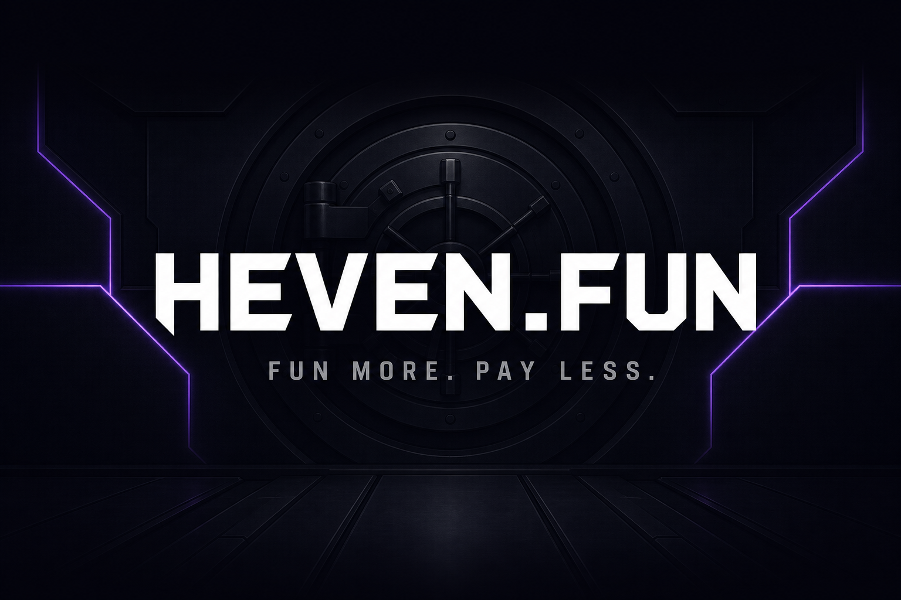
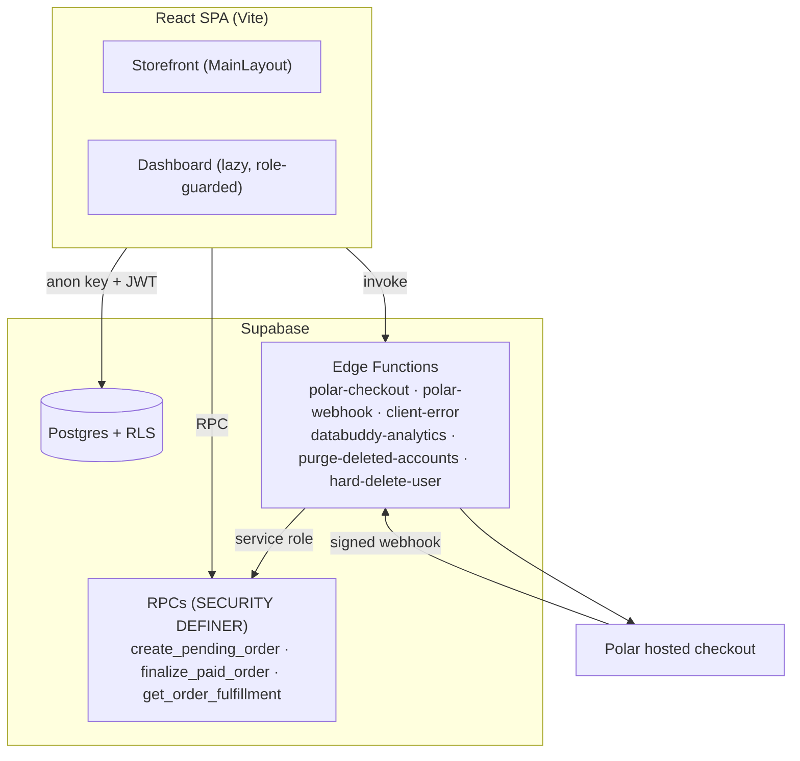

<p align="center">
  
</p>

<p align="center">
  <a href="https://github.com/Tmezjbn/HevenStore/actions/workflows/ci.yml"></a>
  
  
  
  
  
</p>

# HEVEN.FUN

Bilingual (AR/EN, RTL-aware) storefront for games, subscriptions, gift cards and one-time keys, plus a role-guarded dashboard (catalog, orders, users, support desk, badges, themes, website builder). Live: [heven.fun](https://heven.fun) (currently staging at `heven.pages.dev`).

**Stack:** Vite + React 18 + TypeScript · Tailwind CSS 4 + DaisyUI 5 · Zustand · TanStack Query · Supabase (Postgres + RLS, Auth, Storage, Edge Functions) · Polar payments · Databuddy (consent-gated analytics) · Cloudflare Pages.

## Run locally

```powershell
npm install
copy .env.example .env   # fill the VITE_* values
npm run dev              # http://localhost:5173
```

## Environment (names only; see `.env.example`)

- **Client (`VITE_*`, safe to expose):** `VITE_SUPABASE_URL`, `VITE_SUPABASE_ANON_KEY`, `VITE_SITE_URL` (canonical origin; keep equal to Edge `SITE_URL`), `VITE_DATABUDDY_CLIENT_ID`, optional `VITE_SUPABASE_IMAGE_TRANSFORM`.
- **Edge Function secrets (Supabase, never Vite):** `POLAR_ACCESS_TOKEN`, `POLAR_PRODUCT_ID`, `POLAR_WEBHOOK_SECRET`, `POLAR_SERVER`, `SITE_URL`, `PURGE_CRON_SECRET`, Databuddy API key. Setup: [POLAR_SETUP.md](./POLAR_SETUP.md).
- **Deploy tooling (`.env`, gitignored):** `SUPABASE_DB_PASSWORD`, `SUPABASE_ACCESS_TOKEN` (full PAT for function deploys), `CLOUDFLARE_API_TOKEN`, `CLOUDFLARE_ACCOUNT_ID`.

## Verify

```powershell
npm run typecheck; npm run lint; npm test; npm run build
```

`npm test` runs every `scripts/check-*.mjs` (**83** checks, all MUST pass). PowerShell: chain with `;`, not `&&`.

## Ship

| Step | Command |
|------|---------|
| Apply migrations to live Supabase | `npm run db:push` |
| Deploy edge functions (names optional = all) | `npm run deploy:functions -- <names>` |
| Build + deploy site to Cloudflare Pages (`heven`) | `npm run deploy` |

`polar-webhook`, `client-error`, `purge-deleted-accounts` run with JWT verify off (pinned in `supabase/config.toml`). Build needs `VITE_SUPABASE_URL` + `VITE_SUPABASE_ANON_KEY` so the sitemap/prerender include products. Hosting needs `public/_redirects` (SPA rewrite) + `public/_headers` or `vercel.json` (security headers). Point the Polar webhook and Edge `SITE_URL` at the same origin as the SPA. Alerts, uptime, PITR and the pre-launch checklist: **[OPS.md](./OPS.md)** (live state is not verifiable from git).

## Architecture



Checkout is server-authoritative: `CartPage` → `create_pending_order` → `polar-checkout` → Polar → `polar-webhook` → `finalize_paid_order` → `CheckoutSuccessPage` (polls order status). Invariants and file map: [HANDOFF.md](./HANDOFF.md).

## Docs map

| Doc | Use |
|-----|-----|
| [HANDOFF.md](./HANDOFF.md) | Invariants, roles, gotchas, file map, open items. Read before checkout/auth/fulfillment work. |
| [OPS.md](./OPS.md) | Alerts, uptime, PITR, deploy gate, live checklist. |
| [POLAR_SETUP.md](./POLAR_SETUP.md) | Sandbox/prod Polar wiring. |
| [PRODUCT.md](./PRODUCT.md) · [DESIGN.md](./DESIGN.md) | Brand/scope · UI rules. |
| [AGENTS.md](./AGENTS.md) | Short AI read-order. |
| [docs/archive/](./docs/archive/) | Launch audit (2026-07-24) and HANDOFF history. |
